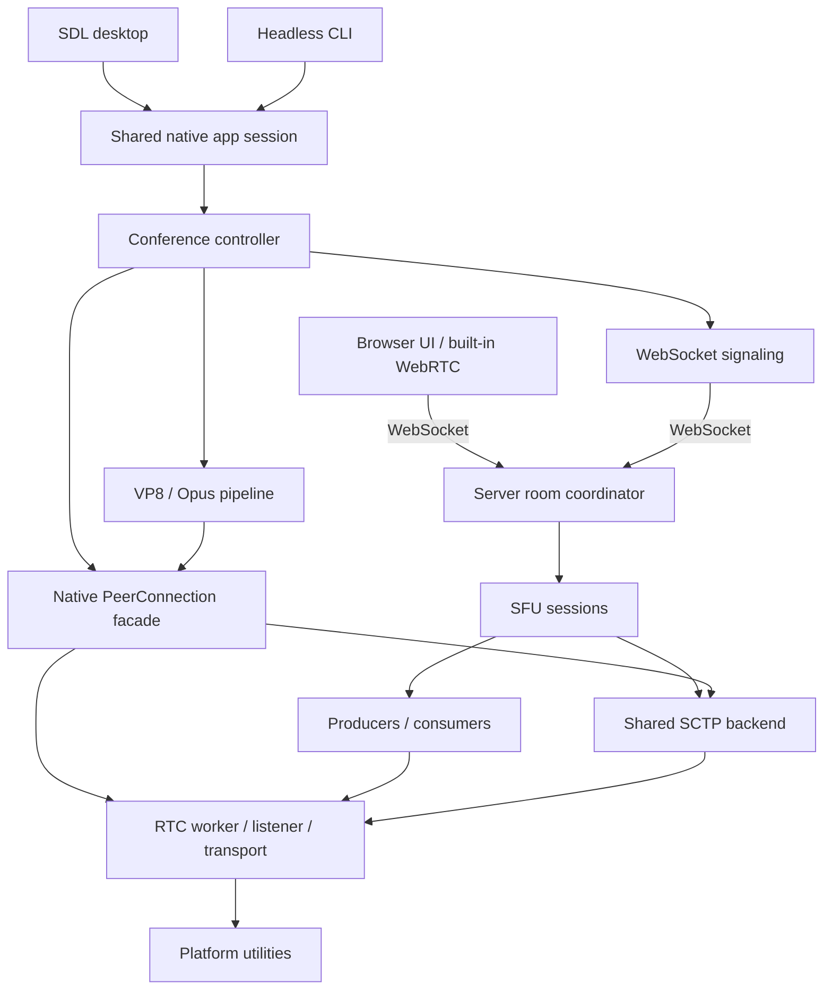
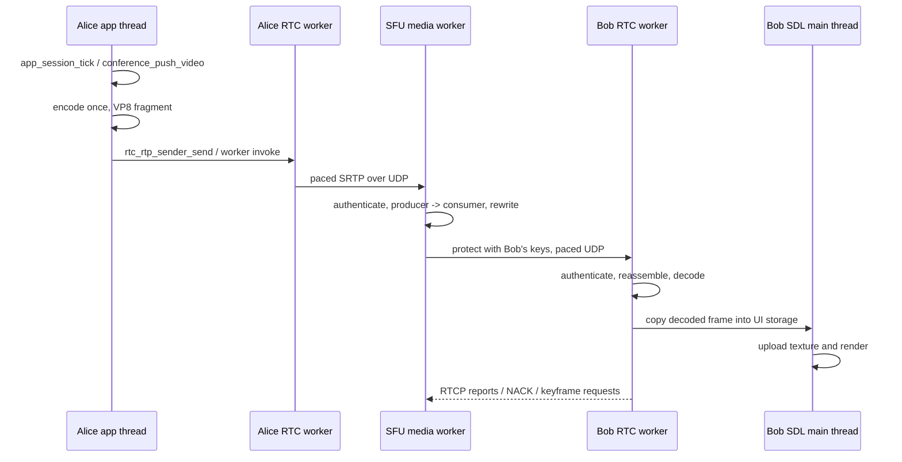

# Architecture

**Control decides who talks; the media runtime moves packets.** Native clients
and browsers share a wire contract, not a WebRTC implementation. The browser
uses built-in WebRTC; native code supplies its own transport and codecs.
Start with the [README](../README.md) for commands, then follow one call below.

## Layers and dependencies

Media bypasses the coordinator's WebSocket path: direct peer-to-peer in mesh,
or encrypted client-to-SFU-to-client in SFU mode. The SFU decrypts/re-encrypts
per hop but never decodes/composites video. It is not participant-to-participant E2EE.
The SFU depends on routing/shared SCTP, **not** native client/codecs.
One server process contains separate control and media threads; there is no IPC.

## Source map

| Directory | Responsibility / starting point |
|---|---|
| [common/](../common/) | Portable sockets, poller support, threads, logging and containers |
| [rtc/](../rtc/) | Workers, listeners, logical transports; ICE/DTLS/SRTP/RTP/RTCP/TURN; shared SCTP |
| [client/](../client/) | PeerConnection, transceivers, senders/receivers and stats |
| [routing/](../routing/) | Router, incoming producers, outgoing consumers and feedback translation |
| [sfu/](../sfu/) | Publisher/subscription negotiation and media graph ownership |
| [signaling/](../signaling/) | JSON wire messages and libwebsockets client |
| [media/](../media/) | Codec backends, codec-selected RTP payload formats, jitter/recovery and media pipeline |
| [conference/](../conference/) | Native participants, sources and active/pending topology graphs |
| [app/common/](../app/common/) | Session lifecycle, synthetic inputs and thread-safe app snapshots |
| [app/server/](../app/server/) | HTTP/WS loop, room policy and stable-ID boundary to SFU |
| [app/desktop/](../app/desktop/), [app/cli/](../app/cli/) | SDL devices/rendering versus headless JSONL/terminal frontend |
| [app/web/](../app/web/) | TypeScript room controller, browser capture and UI |
| [tests/](../tests/) | Shared C harness and [process/controller support](../tests/support/), E2E scenarios and performance tools |

The client and routing libraries are siblings over `mrtc`, not layers on each
other. `mrtc_media` adds codecs to the client; `mrtc_conference` adds signaling.
The browser is not C compiled to WASM. CLI/server need neither SDL nor Node
at runtime; Node builds assets and drives optional tests.

Reusable public APIs live in headers such as [rtc_peer.h](../client/include/rtc/rtc_peer.h),
[rtc_transport.h](../rtc/include/rtc/rtc_transport.h) and [rtc_sfu.h](../sfu/include/rtc/rtc_sfu.h).
`app_session_*` is shared frontend code; `build_graph()`, `publish()` and
`subscribe()` below are internal helpers, not application entrypoints.

## One call: Alice publishes video to Bob through the SFU

Use fixed `--mode sfu` for this example. Bob is already in room `demo`; Alice
joins as `a1b2c3`, Bob is `b4c5d6`, epoch is 1. IDs/packet values here are
illustrative, not configured constants.

### Join and negotiate

| Step / thread | Call and resulting state |
|---|---|
| Alice app thread | [app_session_start](../app/common/app_session.c) validates options, increments `generation`, creates conference/sources, and sets up signaling; accepted is not connected. |
| Same thread | `conference_join()` binds the signaling client; `signaling_connect()` starts its network thread. Snapshot becomes active while `joined` is still false. |
| Server control loop | [handle_message](../app/server/main.c) parses join; `meeting_join_message()` admits Alice and replies with concrete mode, identity, epoch and Bob's ID. |
| Alice signaling thread | [sig_on_event](../conference/src/conference.c) records identity/epoch and calls `build_graph()`; publishing session is `p:1:a1b2c3`. Offers/candidates carry this identity. |
| Server control to media worker | `meeting_validate_session()` checks ownership; [rtc_sfu_handle](../sfu/src/rtc_sfu.c) copies the command and synchronously invokes `handle_worker()` on the SFU worker. |
| SFU worker | `publish()` applies SDP, creates producers and an answer; `subscribe()` creates Bob's consumer session `s:1:b4c5d6:a1b2c3`. Events are copied back to the control queue for WS delivery. |
| Both RTC workers | ICE selects an authenticated path; fingerprint-verified DTLS exports SRTP keys; SCTP opens for chat. Only then can media/data flow. |

The [wire protocol](PROTOCOL.md) defines exact message/identity rules. Invalid
descriptions do not mutate a working graph. This is asynchronous negotiation:
a successful join command or ICE state alone is not decoded-media readiness.

### Follow one video frame

1. [app_session_tick](../app/common/app_session.c) produces synthetic `camera`
   video at 15 fps. Real devices push frames through the same conference API.
2. [conference_push_video](../conference/src/conference.c) pins eligible peer
   sessions and serializes pipeline access. `media_pipeline_push_video()`
   encodes once, selects [Video payload ops](../media/src/video_payload.h) by codec,
   and fans out to senders. Payload ops own fragment/reassembly state and limits;
   encoder ops remain independent. VP8 is the sole current video implementation.
3. [rtc_rtp_sender_send](../client/src/rtc_track.c) delegates to
   `rtc_rtp_send_stream_send()`, which invokes the RTC worker. Fragments of one
   frame share a timestamp; the marker advances a 90 kHz clock by 6000 at 15 fps.
4. The worker builds/protects RTP and uses bounded video pacing. Example:
   payload type 96, SSRC `0x11223344`, sequence 100, timestamp 90000.
5. On the SFU worker, the listener/transport authenticates and demultiplexes
   plaintext RTP to [rtc_producer_on_rtp](../routing/src/rtc_producer.c).
   `rtc_consumer_on_producer_rtp()` rewrites for Bob, for example to SSRC
   `0x55667788`, sequence 40000, retaining timestamp/payload.
6. [The consumer](../routing/src/rtc_consumer.c) keeps bounded repair history
   and calls `rtc_transport_send_rtp_media()`; Bob's hop has independent keys.
   Bob's worker decrypts, reassembles and decodes; callbacks copy frames/audio.
   The CLI counts decoded output; SDL uploads/renders only on its main thread.

Audio RTP queues codec-duration packets using its 48 kHz clock. The existing
media-session worker timer drains due audio independently of packet arrivals,
with at most 120 ms of Opus concealment before pausing/rebuffering. Contiguous
sequence numbers with timestamp gaps preserve DTX silence. Concealed samples
are rendered but do not count as fresh received media for topology readiness.

Feedback belongs to each leg's SSRC/sequence space. Consumers repair downstream
loss from bounded history or request a new publisher keyframe; blindly relaying
a rewritten NACK upstream would identify the wrong packet.

## Threads, ownership and shutdown

| Owner | Owns / must not do |
|---|---|
| Server control loop | Rooms, WebSockets, policy; do not retain borrowed worker-event storage |
| SFU media worker | Session transports, producers/consumers, timers and packet callbacks |
| Native app/main thread | Session lifecycle, capture/encoding ticks; all SDL device/texture operations |
| Native signaling thread | WS callbacks and graph negotiation; peer operations marshal to RTC worker |
| Conference topology thread | Pending readiness checks; does not encode/render media |
| Native RTC worker | Socket dispatch, crypto/stream operations, timers, receive/decode callbacks |
| Browser controller | UI/capture/session selection; browser owns transport/media internals |

- A listener owns a socket; multiple logical transports share routing over it.
  Listeners gather local candidates; each transport owns an ICE agent from
  [rtc_ice.c](../rtc/src/rtc_ice.c) for credentials, checks, nomination, consent
  and restart state. ICE shares the transport worker and send mutex; the
  transport supplies direct/TURN packet I/O and retains crypto ownership.
  Separate remote DTLS associations need distinguishable tuples. SFU
  subscriptions deliberately use extra ephemeral listeners: simpler ownership,
  at the cost of ports/connections rather than one bidirectional PC per user.
- Heap runtime objects follow create -> close -> destroy; caller-allocated
  primitives use init -> close. Consult public headers for exact ownership.
- Native sends pin session lifetime, then release the send lock before a
  synchronous worker call. Callback teardown must finish before UI/session
  state is freed. SRTP replay/nonce state is not reset to recycle source IDs.
- [app_session_stop](../app/common/app_session.c) leaves the conference, stops
  signaling, destroys conference state and generators, then releases runtime
  setup. Rejoin clears the snapshot and advances local `generation`.

## Topology changes without losing the call

AUTO counts admitted participants, including muted ones. Default: up to two
use mesh; a third triggers SFU preparation; returning to two waits 15 seconds.
The coordinator, not each client, authorizes changes.

| Cause | Effect |
|---|---|
| `topology_prepare` | Build a new epoch alongside active sessions; old media continues |
| Pending sessions/media ready | Client sends ready; muted/inactive tracks must not block forever |
| `topology_commit` | Select pending graph once; preserve participant IDs, capture and tile identity |
| Ack/retirement | Drain old sessions; deduplicate overlapping chat by sender/message ID |
| Timeout, membership change or error | Abort/reconcile pending work; do not erase the working graph |
| Actual P2P connectivity failure | Request server-authorized SFU fallback; avoid repeated downgrade loops |

An epoch is a topology generation, not a participant ID or local call generation.
An ICE restart keeps the endpoint/session while changing ICE credentials;
switching remote endpoints creates new DTLS/SCTP sessions.

Native session retirement shares one ownership-aware cleanup path. Browser
graph/participant retirement also closes channel handlers, so delayed callbacks
cannot deliver messages from an already removed session.

## Where to make a change

| Change | Start here; add focused coverage |
|---|---|
| Packet/transport behavior | [rtc/src/](../rtc/src/) and [rtc/tests/](../rtc/tests/); ICE changes need component and active runtime coverage |
| Public native peer behavior | [client/include/rtc/](../client/include/rtc/) and peer integration tests |
| Forwarding/feedback | [routing/src/](../routing/src/), then SFU session tests |
| Room/topology policy | [meeting.c](../app/server/meeting.c), topology/runtime tests, then migration E2E |
| Codec/source behavior | [media/src/](../media/src/), pipeline tests, then native E2E |
| Frontend | Respective [desktop](../app/desktop/), [CLI](../app/cli/) or [web](../app/web/); preserve shared session/wire contracts |

Use [testing](TESTING.md) to choose commands, [standards](STANDARDS.md) for
supported subsets, and [roadmap](ROADMAP.md) for unresolved qualification.
